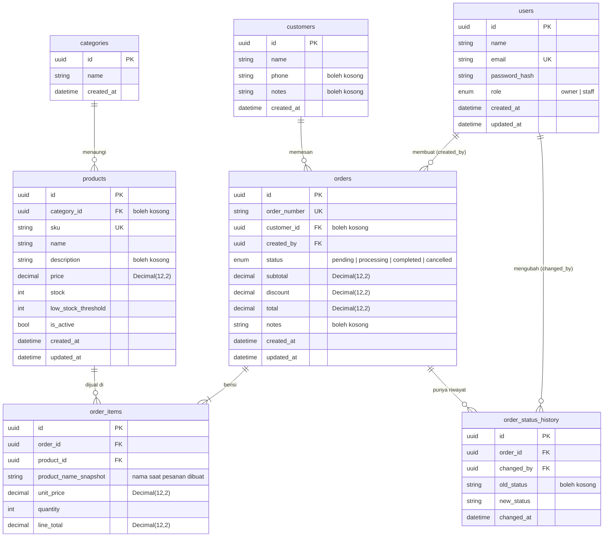

# ERD NiagaFlow

Diagram relasi database (Mermaid). GitHub menampilkannya otomatis.

## Catatan penting

- **Uang** disimpan sebagai `Decimal(12,2)` di database, tapi dikirim ke frontend sebagai bilangan bulat rupiah. Lihat `apps/api/src/utils/serialize.ts`.
- **Nama produk disalin** ke `order_items.product_name_snapshot` saat pesanan dibuat. Jadi kalau produk nanti diganti nama, riwayat pesanan lama tidak ikut berubah.
- **Stok** dikurangi saat pesanan dibuat dan dikembalikan saat pesanan dibatalkan, keduanya dalam satu transaksi database.
- **Riwayat status** disimpan terpisah di `order_status_history`, mencatat siapa yang mengubah, dari status apa, ke status apa, dan kapan.
- **Pelanggan bersifat opsional** pada pesanan (`customer_id` boleh kosong) untuk pesanan langsung di tempat.
